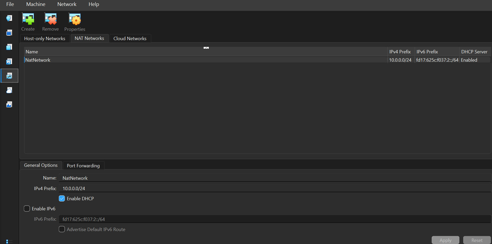
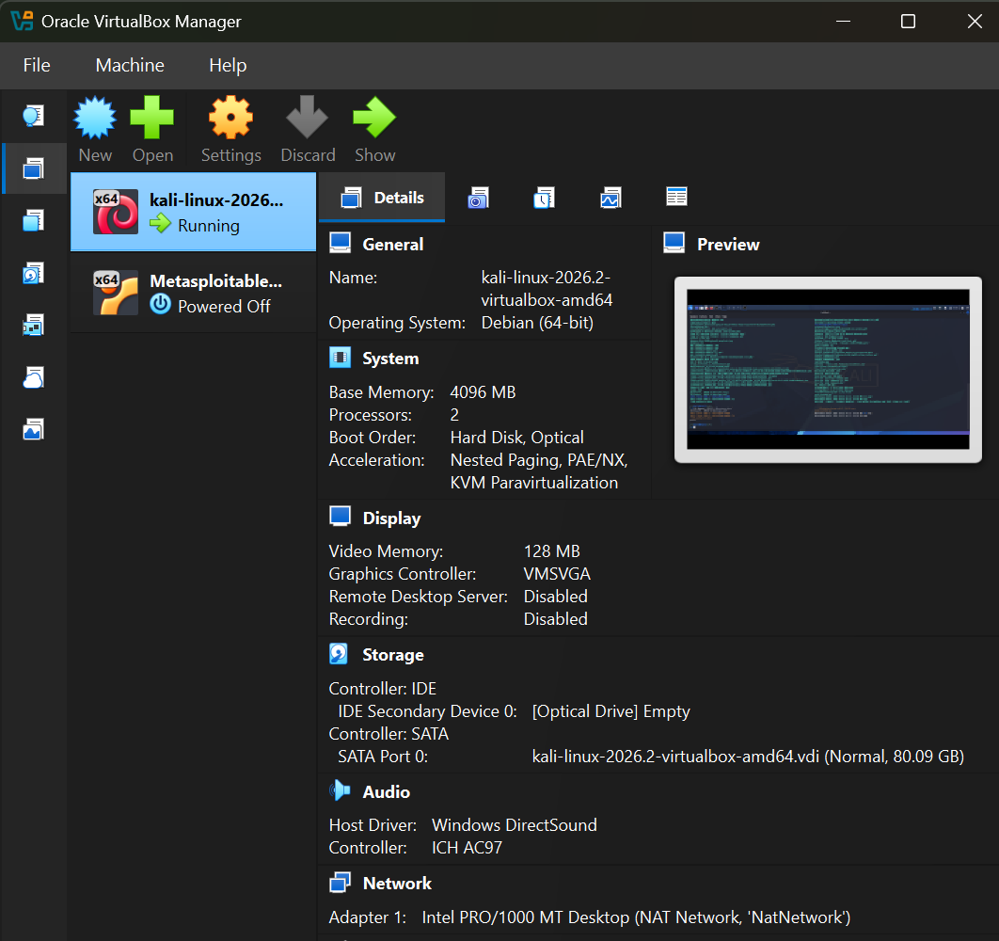

# NETWORKWALKS-SHEILA-B084-WK1-PM1-CYBERSECURITY-LAB-SETUP

**Networkwalks Cybersecurity Internship | Week 1 | Project Module 1**
**Intern:** Sheila Chepkoech

## Objective

Build an isolated cybersecurity testing lab on my own laptop, with Kali Linux as the attacking machine, so I can safely practise ethical hacking and network security in later weeks.

## Lab requirements and status

| Requirement | Status |
|---|---|
| Use VirtualBox as the base (latest recommended version) | Done: VirtualBox 7.2.22 |
| Set up Kali Linux as the attacking machine | Done |
| Network in subnet 10.0.0.0/24 using a NAT Network | Done: `NatNetwork` |
| Clipboard and drag/drop enabled in VM settings | Done: Bidirectional, clipboard tested |
| Shared folder with the host's Downloads folder | Done: mounted at `/media/sf_Downloads` |
| Kali IP address is 10.0.0.2/24 | Done |
| Kali has full internet access | Done: ping and DNS tests passed |
| Snapshot of the VM | Done |

## Lab environment

- **Host OS:** Windows
- **Hypervisor:** Oracle VirtualBox 7.2.22
- **Attacking machine:** Kali Linux 2026.2 (VirtualBox image), 4 GB RAM, 2 CPUs
- **Network:** NAT Network `NatNetwork`, 10.0.0.0/24, DHCP enabled
- **Kali IP:** 10.0.0.2/24, gateway 10.0.0.1, DNS 8.8.8.8

## Steps

### 1. Install the latest VirtualBox

I checked for updates in VirtualBox (File > Check for Updates), downloaded the latest installer from virtualbox.org and installed it over the old version with the default options. My existing VMs were kept. The About screen confirms version 7.2.22.


### 2. Create the NAT Network

In **File > Tools > Network > NAT Networks**, I edited the existing `NatNetwork` and set the IPv4 prefix to `10.0.0.0/24` with DHCP enabled and IPv6 disabled.



### 3. Attach the Kali VM to the NAT Network

In the Kali VM **Settings > Network > Adapter 1**:
- Attached to: **NAT Network**
- Name: **NatNetwork**
- Promiscuous Mode: **Allow All**


### 4. Enable the shared clipboard and drag and drop

In **Settings > General > Features**, I set both **Shared Clipboard** and **Drag-and-Drop** to **Bidirectional**.


### 5. Share the Downloads folder from the host

In **Settings > Shared Folders**, I added the Windows Downloads folder as a global shared folder named `Downloads` with **Auto-mount** enabled and full access.


### 6. Set the static IP and test internet access

Inside Kali I set a manual IP address with `nmcli`:

```bash
sudo nmcli connection modify "Wired connection 1" ipv4.method manual ipv4.addresses 10.0.0.2/24 ipv4.gateway 10.0.0.1 ipv4.dns 8.8.8.8
```

Then I applied the internet connectivity fix for VirtualBox 7 and newer Kali versions, and reconnected:

```bash
sudo nmcli connection modify "Wired connection 1" ipv4.dad-timeout 0
sudo nmcli connection down "Wired connection 1"
sudo nmcli connection up "Wired connection 1"
```

Verification:

```bash
ip a
ping -c 3 8.8.8.8
ping -c 3 google.com
```

`eth0` shows `10.0.0.2/24`, and both pings returned replies with 0% packet loss. This confirms internet access and DNS resolution.


### 7. Check the shared folder inside Kali

```bash
ls /media/sf_Downloads
```

The command lists the files from my Windows Downloads folder, so the share works. (The file names in this screenshot are blurred for privacy.)


### 8. Confirm the VM is on the NAT Network

The VirtualBox Manager shows the Kali VM running with Adapter 1 on **NAT Network, 'NatNetwork'**.



### 9. Take a snapshot

I took a snapshot named **Week1 - Lab Setup Complete (10.0.0.2)** so I can restore the lab to a clean working state at any time.


## What I learned

- How a VirtualBox NAT Network works and why an isolated network keeps a hacking lab safe.
- How to give a Linux machine a static IP address with `nmcli`.
- How to troubleshoot VM internet problems: check the network settings, the IP conflicts, the gateway and DNS, and the connectivity fix commands.
- How shared folders and the shared clipboard connect a host and a VM.
- Why snapshots matter: they give me a safe restore point before I start testing.

## Conclusion

The lab meets every requirement of the task. Kali Linux is ready as my attacking machine on an isolated NAT Network, and it has full internet access. 
