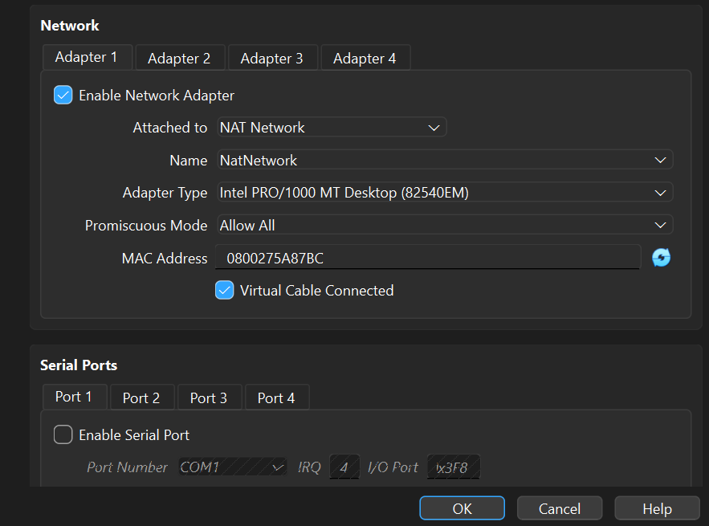
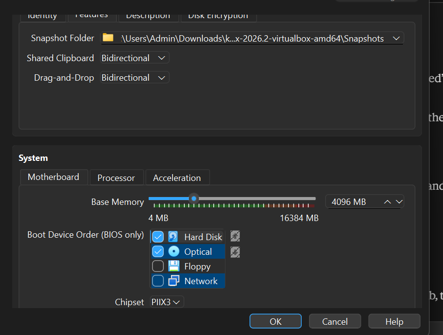
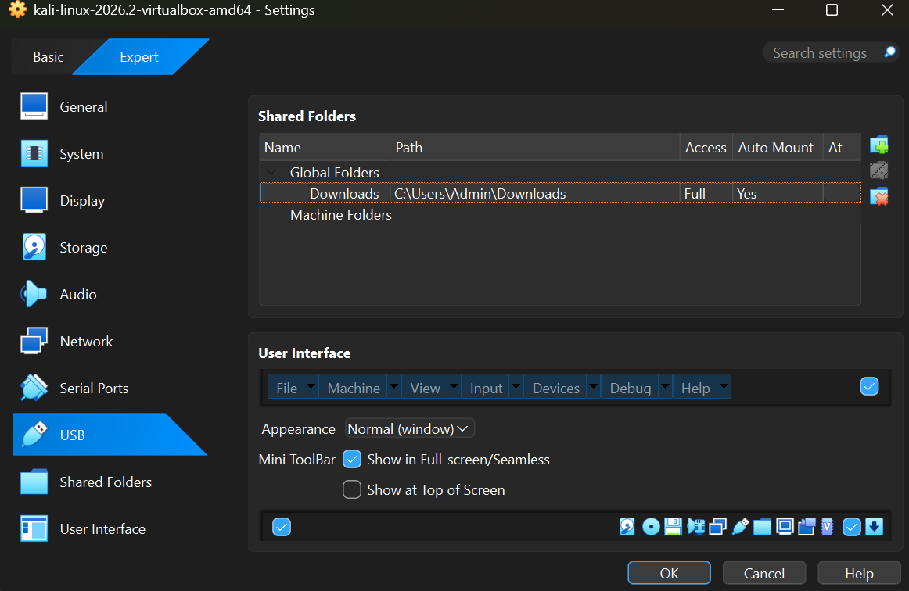
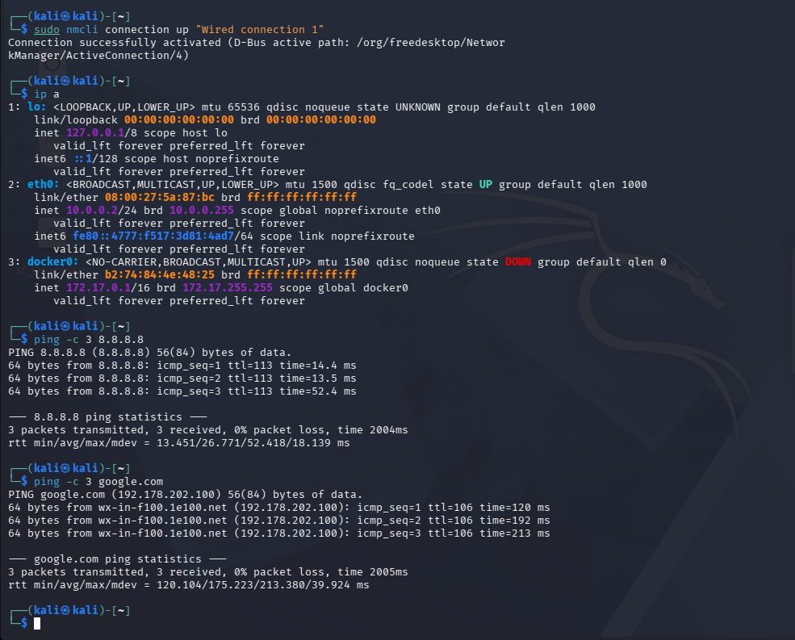
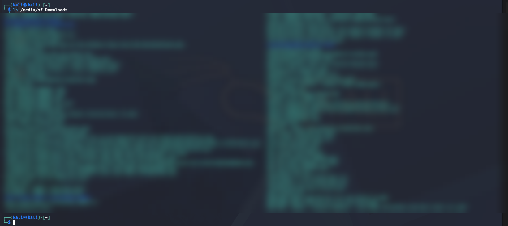
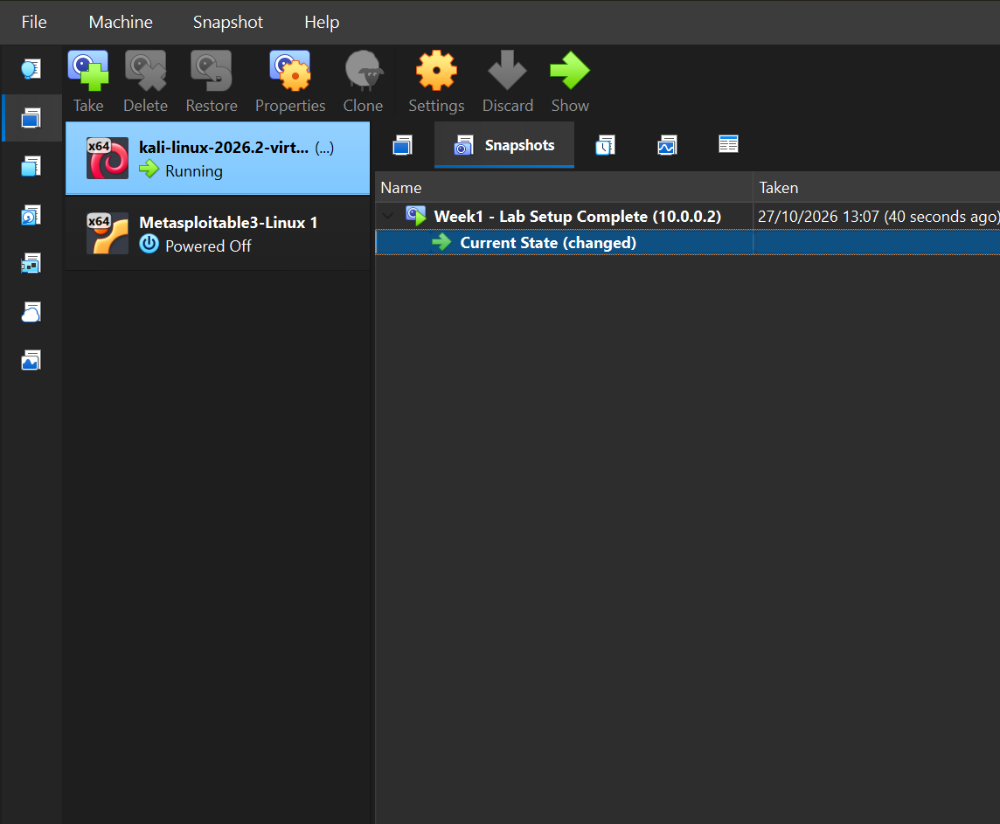

# NETWORKWALKS-SHEILA-B084-WK1-PM1-CYBERSECURITY-LAB-SETUP

**Networkwalks Cybersecurity Internship | Week 1 | Project Module 1**
**Intern:** Sheila Chepkoech

## Objective

Build an isolated cybersecurity testing lab on my own laptop, with Kali Linux as the attacking machine, so I can safely practise ethical hacking and network security in later weeks.

## Lab requirements and status

| Requirement | Status |
|---|---|
| Use VirtualBox as the base (latest recommended version) | Done: VirtualBox 7.2.22 |
| Set up Kali Linux as the attacking machine | Done |
| Network in subnet 10.0.0.0/24 using a NAT Network | Done: `NatNetwork` |
| Clipboard and drag/drop enabled in VM settings | Done: Bidirectional, clipboard tested |
| Shared folder with the host's Downloads folder | Done: mounted at `/media/sf_Downloads` |
| Kali IP address is 10.0.0.2/24 | Done |
| Kali has full internet access | Done: ping and DNS tests passed |
| Snapshot of the VM | Done |

## Lab environment

- **Host OS:** Windows
- **Hypervisor:** Oracle VirtualBox 7.2.22
- **Attacking machine:** Kali Linux 2026.2 (VirtualBox image), 4 GB RAM, 2 CPUs
- **Network:** NAT Network `NatNetwork`, 10.0.0.0/24, DHCP enabled
- **Kali IP:** 10.0.0.2/24, gateway 10.0.0.1, DNS 8.8.8.8

## Steps

### 1. Install the latest VirtualBox

I checked for updates in VirtualBox (File > Check for Updates), downloaded the latest installer from virtualbox.org and installed it over the old version with the default options. My existing VMs were kept. The About screen confirms version 7.2.22.


### 2. Create the NAT Network

In **File > Tools > Network > NAT Networks**, I edited the existing `NatNetwork` and set the IPv4 prefix to `10.0.0.0/24` with DHCP enabled and IPv6 disabled.


### 3. Attach the Kali VM to the NAT Network

In the Kali VM **Settings > Network > Adapter 1**:
- Attached to: **NAT Network**
- Name: **NatNetwork**
- Promiscuous Mode: **Allow All**



### 4. Enable the shared clipboard and drag and drop

In **Settings > General > Features**, I set both **Shared Clipboard** and **Drag-and-Drop** to **Bidirectional**.



### 5. Share the Downloads folder from the host

In **Settings > Shared Folders**, I added the Windows Downloads folder as a global shared folder named `Downloads` with **Auto-mount** enabled and full access.



### 6. Set the static IP and test internet access

Inside Kali I set a manual IP address with `nmcli`:

```bash
sudo nmcli connection modify "Wired connection 1" ipv4.method manual ipv4.addresses 10.0.0.2/24 ipv4.gateway 10.0.0.1 ipv4.dns 8.8.8.8
```

Then I applied the internet connectivity fix for VirtualBox 7 and newer Kali versions, and reconnected:

```bash
sudo nmcli connection modify "Wired connection 1" ipv4.dad-timeout 0
sudo nmcli connection down "Wired connection 1"
sudo nmcli connection up "Wired connection 1"
```

Verification:

```bash
ip a
ping -c 3 8.8.8.8
ping -c 3 google.com
```

`eth0` shows `10.0.0.2/24`, and both pings returned replies with 0% packet loss. This confirms internet access and DNS resolution.



### 7. Check the shared folder inside Kali

```bash
ls /media/sf_Downloads
```

The command lists the files from my Windows Downloads folder, so the share works. (The file names in this screenshot are blurred for privacy.)



### 8. Confirm the VM is on the NAT Network

The VirtualBox Manager shows the Kali VM running with Adapter 1 on **NAT Network, 'NatNetwork'**.


### 9. Take a snapshot

I took a snapshot named **Week1 - Lab Setup Complete (10.0.0.2)** so I can restore the lab to a clean working state at any time.



## What I learned

- How a VirtualBox NAT Network works and why an isolated network keeps a hacking lab safe.
- How to give a Linux machine a static IP address with `nmcli`.
- How to troubleshoot VM internet problems: check the network settings, the IP conflicts, the gateway and DNS, and the connectivity fix commands.
- How shared folders and the shared clipboard connect a host and a VM.
- Why snapshots matter: they give me a safe restore point before I start testing.

## Conclusion

The lab meets every requirement of the task. Kali Linux is ready as my attacking machine on an isolated NAT Network, and it has full internet access. # Wireshark SOC Labs

**Networkwalks Cybersecurity Internship | Wireshark SOC Lab series**
**Intern:** Sheila Chepkoech

## Objective

Work as a SOC analyst: capture live traffic in Wireshark, filter it, and use Follow TCP Stream to find attacks and sensitive data sent in plain text.

## Results

| Lab | Topic | Date | Score |
|-----|-------|------|-------|
| Lab 3 | Identify the Attacker's IP | 29 Oct 2026 | 100 / 100 |
| Lab 4 | Follow TCP Stream | 29 Oct 2026 | 90 / 100 |
| Lab 5 | Follow TCP Stream, part 2 | 28 Oct 2026 | 100 / 100 |
| Lab 6 | HTTP plain text credentials | 28 Oct 2026 | 100 / 100 |
| Lab 7 | Brute force catch | 28 Oct 2026 | 80 / 100 |
| Lab 8 | VoIP call replay | 29 Oct 2026 | 100 / 100 |

**Total: 570 / 600 (95%)**

## Wireshark skills used

- Capturing on the active interface and reading the packet count in the status bar
- Display filters such as `tcp.flags.syn == 1`, `http.request` and `frame contains "<!--"`
- Statistics > Conversations to find the busiest hosts and ports
- Follow > TCP Stream to read whole conversations (red = client, blue = server)
- Reading TCP flags (SYN, SYN-ACK, RST-ACK) to tell open ports from closed ones

---

## Lab 3: Identify the Attacker's IP (100 / 100)


**Scenario:** A staff member reported unusual traffic to the company web server. I captured the packets to find the attack type and the attacker's IP. The SOC analyst PC (192.168.10.10) captured from a switch SPAN port, and the web server is 192.168.10.20.

| # | Task | Method | Answer |
|---|------|--------|--------|
| 1 | Capture the traffic | Double-click the active **WiFi** interface, then stop | 309 packets |
| 2 | Show only SYN packets | Filter `tcp.flags.syn == 1` | 73 displayed |
| 3 | Find the attacker | One source sends a long block of SYNs from 3.4 s | 192.168.10.66 |
| 4 | Find the target | Destination of that block | 192.168.10.20 (web server) |
| 5 | Source port | Number before the arrow in the Info column | 52311 |
| 6 | Ports probed | Statistics > Conversations > TCP (one row per port) | 40 |
| 7 | Open ports | Server replied `[SYN, ACK]` | 22, 80, 443 |
| 8 | Reply for closed ports | Server replied with a reset | RST, ACK |
| 9 | Closed ports | 40 tried - 3 open | 37 |
| 10 | Attack type | One host, many ports, very fast | Port scan (TCP SYN scan) |

**Why a port scan and not a SYN flood:** every probe used the same source port (52311) and a different destination port, about 12.5 ms apart, which means an automated tool. The attacker wanted the replies to learn which services are open. A flood would hit one port with huge volumes of SYNs.

**What I learned:** one host opening dozens of connections in a row stands out in Statistics > Conversations. A scan is usually the first step before an attack on the open services (here SSH and the web ports), so it should be detected and blocked early, for example with firewall rate limits or IDS rules for SYN scans.

---

## Lab 4: Follow TCP Stream (90 / 100)


**Scenario:** Some staff use an old office chat tool that sends messages in plain text. I used Follow TCP Stream to read one chat and see what was shared.

| # | Task | Method | Answer |
|---|------|--------|--------|
| 1 | Capture the traffic | Start and stop a capture | Done |
| 2 | Find the chat port | TCP traffic that is not port 80 or 443 | 5000 (marked wrong, see note) |
| 3 | Who started the chat | Source of the first SYN to port 5000 | 192.168.10.45 |
| 4 | Stream number | Follow > TCP Stream title `tcp.stream eq N` | 5 |
| 5 | Size of the chat | Bottom bar: Entire conversation | 413 bytes |
| 6 | Who needs help | Red (client) text | Ali, from Accounts |
| 7 | The problem drive | Read the chat | Finance drive |
| 8 | Temporary password | Sent by IT (Sara) | Tiger#4821 |
| 9 | Guest Wi-Fi password | Sent by IT | BlueHarbor77 |
| 10 | Text colour | Client text | Red |

**Note on task 2:** The platform marked this wrong. A later question in the same lab states "The chat uses TCP port 5000", and the first SYN in the capture (frame 81) goes to port 5000, so the finding is consistent.

**What I learned:** the chat ("Office Chat v1.2") was fully readable, including a temporary password and the guest Wi-Fi password. Chat tools should use TLS, and passwords should never be shared over chat.

---

## Lab 5: Follow TCP Stream, part 2 (100 / 100)


**Scenario:** A staff member browsed the company intranet and an admin thought a secret was left inside a web page. I captured the traffic and used Follow TCP Stream to find it.

| # | Task | Method | Answer |
|---|------|--------|--------|
| 1 | Capture the traffic | Start and stop a capture | Done |
| 2 | Find the pages | Filter `http.request` | Five pages opened by 192.168.10.45: help, index, about, staff, contact |
| 3 | Where is it hidden | Searched with `frame contains "<!--"` | In an HTML comment |
| 4 | Find the stream | `[Stream index]` in the TCP section | 7 |
| 5 | The code word | Inside the comment | Falcon-9921 |
| 6 | The backup server | Inside the comment | 192.168.10.77 |
| 7 | Which direction | Blue text in Follow TCP Stream | Server to client |
| 8 | Status code | Start of the server reply | 200 (OK) |
| 9 | The downloaded file | `GET /download/report.txt` | report.txt |
| 10 | Who made the report | Read the file in Follow TCP Stream | Answered correctly |

**Capture evidence:** my own Wireshark window with the `http.request` filter applied, listing the intranet page requests to the web server (192.168.10.20).


The page `/staff.html` ended with: `<!-- IT note: backup server is 192.168.10.77, access code Falcon-9921. Remove before publishing. -->`

**What I learned:** `http contains` is not a valid filter because `http` is a protocol, not a field, so `frame contains "..."` works instead. Browsers hide comments, but they travel over the network in plain text, so secrets must be removed before a page is published and sites should use HTTPS.

---

## Lab 6: HTTP plain text credentials (100 / 100)


Tasks: capture the traffic, which protocol, the method, the login page, the PC that signed in, how many attempts, the username, the password, the packet details line, and the fix.

Login details sent over plain HTTP can be read in the capture. HTTPS protects them in transit.

---

## Lab 7: Brute force catch (80 / 100)


Tasks: capture the traffic, the protocol, the target, the attacker, the username, failure code, failed logins, success code, the password that worked, and the attack type. Tasks 2 (protocol) and 7 (failed logins) were marked wrong.

A brute force attack shows up as many failed login replies from one source against one target, followed by a success.

---

## Lab 8: VoIP call replay (100 / 100)


Tasks: capture the traffic, call setup protocol, voice protocol, caller extension, caller name, the codec, who answered, card number, expiry date, and the fix.

Unencrypted VoIP calls can be replayed from a capture, including sensitive details spoken on the call. Encrypting call signalling and audio is the fix.
